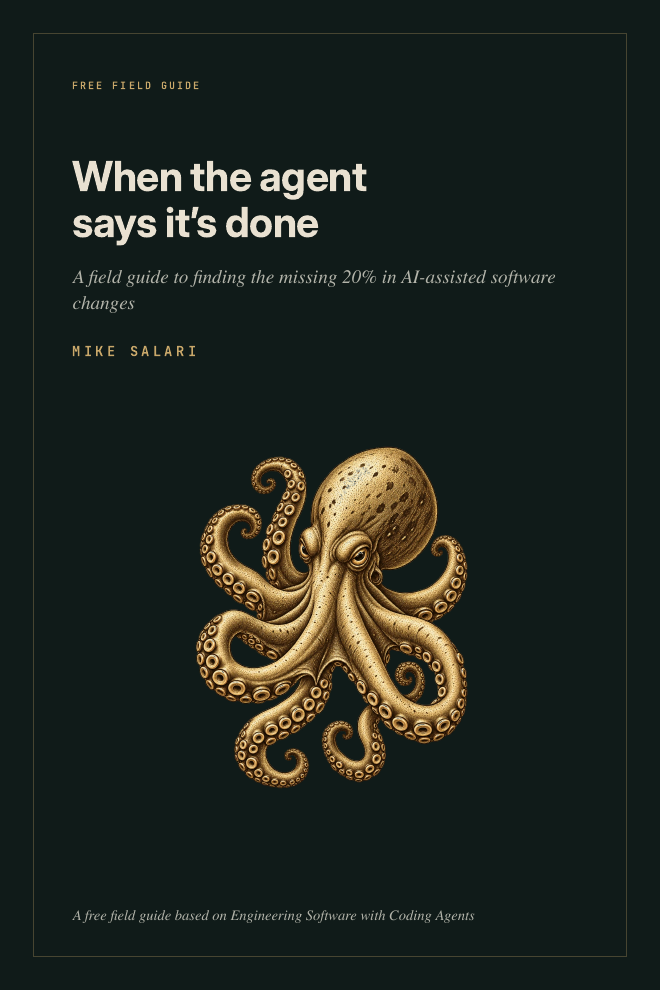

# When the agent says it's done

**A field guide to finding the missing 20% in AI-assisted software changes.**

Free sample of *Engineering Software with Coding Agents* by **Mike Salari** · [salari.dev](https://salari.dev)

[**Read on desktop**](Engineering-Software-with-Coding-Agents-sample-desktop.pdf) · [**Read on your phone**](Engineering-Software-with-Coding-Agents-sample-mobile.pdf) · [**Get the full book**](https://mikesalari.gumroad.com/l/coding-agents?utm_source=github&utm_medium=sample&utm_campaign=coding_agents_launch_2026)

---

## The diff looks fine. The feature doesn't work.

A team asks a coding agent for scheduled status updates. The agent adds a date picker, the API accepts a `scheduledAt` field, and a test passes. The agent reports success.

When the scheduled time arrives, nothing publishes the update.

Every changed file does what it says. The missing work sits between them: the job that picks up due updates, the account it runs under, the retry rules, and the evidence that anything was sent. A reviewer who reads only the diff approves it.

This guide shows how to catch that before you merge.

## What's inside

- **Write the claim before the agent writes code.** Turn a ticket into behavior you can check across the running system, not just the files that changed.
- **Run a six-check review.** Trigger, boundary, state, negative path, deployment, observability. Each one asks for evidence, not a reassurance.
- **Ask the agent for a claim-to-evidence report.** A prompt you can reuse, and how to read its answer without trusting it blindly.
- **Hand off decisions, not chat history.** A checkpoint file that stops the next session from reopening what you already rejected.
- **Know what actually enforces a rule.** Why "do not use the network" in an instruction file is not the same as a blocked network.
- **Read a real session.** A recorded Claude Code run, with the three lines that show what it proved and what it didn't.

The Relay example is a teaching case. The Claude Code session is recorded. The guide says which is which.

## Pick your screen

| Edition | Best for | Pages | Open |
| --- | --- | ---: | --- |
| **Desktop** | Laptop, large screen, print | 12 | [Desktop PDF](Engineering-Software-with-Coding-Agents-sample-desktop.pdf) |
| **Mobile** | Reading on a phone, no zooming | 16 | [Mobile PDF](Engineering-Software-with-Coding-Agents-sample-mobile.pdf) |

Same content, two layouts. Free, no email, no sign-up.

## The full book

*Engineering Software with Coding Agents* takes the same Relay change from ticket to release: investigation, context, delegation, permissions, tests, review, CI and rollout.

| Edition | What you get | Price |
| --- | --- | ---: |
| **Book** | PDF and EPUB. 371 pages, 18 chapters, five appendices, nine annotated spreads (seven from recorded sessions) | $149 |
| **Book + Companion** | The book, plus the runnable Relay lab in 7 Git-tagged stages, 22 configuration files for Claude Code, Codex, Git, GitHub and MCP, a workbook, templates, a session casebook and a Swift case study with 20 tests. 13 companion PDFs | $299 |

**[Get it on Gumroad](https://mikesalari.gumroad.com/l/coding-agents?utm_source=github&utm_medium=sample&utm_campaign=coding_agents_launch_2026)**

## Who it's for

Senior, staff and principal engineers, tech leads, and experienced developers using coding agents on real codebases. Backend, frontend, mobile and platform work alike. You should already be comfortable with Git, testing and code review.

## About the author

**Mike Salari** is a Staff mobile engineer. 15 years across Apple, Adobe, Cisco, Mastercard and Visa, and 500+ technical interviews from the hiring side. He writes about software engineering and careers at [salari.dev](https://salari.dev).

[Website](https://salari.dev) · [LinkedIn](https://www.linkedin.com/in/mike-salari/)

## Sharing and copyright

© 2026 Mike Salari. All rights reserved.

Share the link to this repository freely. The PDFs are free to read for personal use. They are not licensed for redistribution, adaptation or commercial use. For anything beyond reading, ask the author first.
